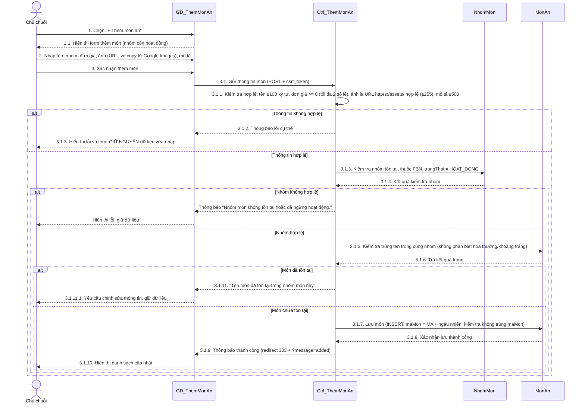
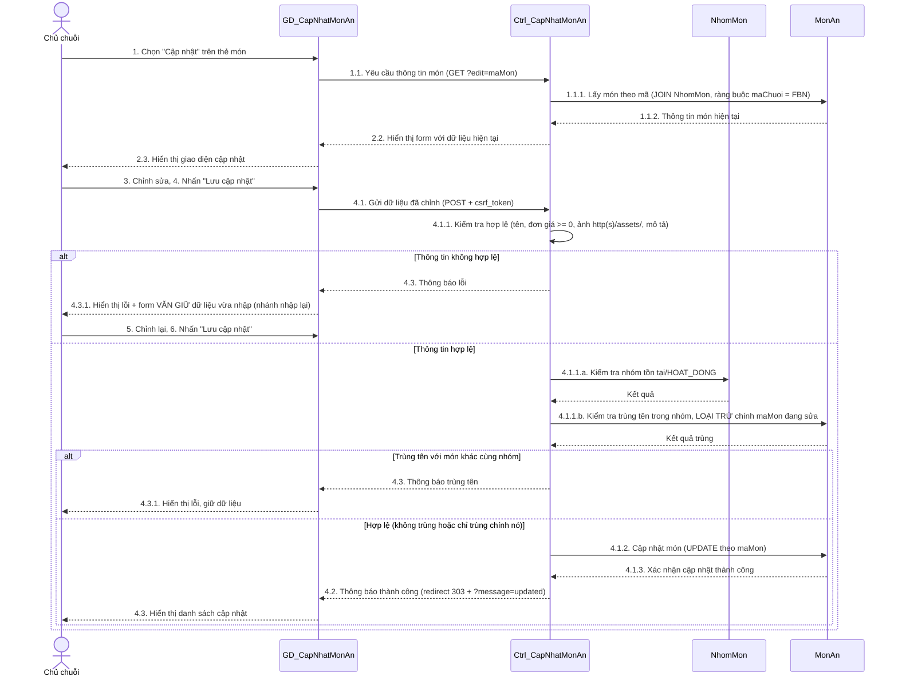
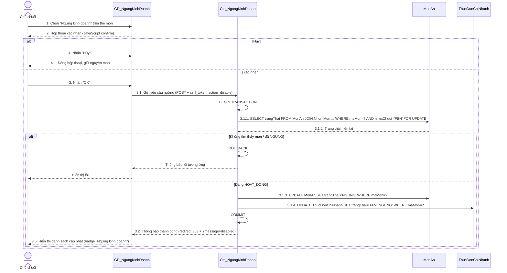
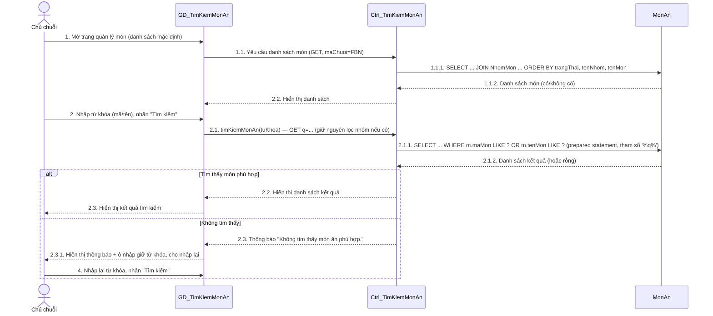

# Sequence món ăn — bản cập nhật sau rà soát (SD-19 / SD-21 / SD-22 / SD-23)

- Trạng thái: **đã sửa trong code và kiểm tra cú pháp** (`modules/mon-an/index.php`, `includes/functions.php`, `modules/goi-mon/index.php`, `assets/js/app.js`).
- Ngày cập nhật: 26/11/2026.
- Căn cứ: `docs/database_v2/RA_SOAT_32_SEQUENCE.md` (SD-19, SD-21, SD-22, SD-23) và baseline database V2.
- Người thực hiện: Trần Như Ý (nhóm món ăn / thực đơn toàn chuỗi).
- Sơ đồ vẽ bằng Mermaid — GitHub render trực tiếp, không cần Visual Paradigm. Luồng xác thực, phân quyền (`menu.manage`), CSRF (`require_csrf`), khóa giao dịch (`FOR UPDATE`) nằm trong code và **không** bị tách thành use case mới.

## 1. Bảng tổng hợp thay đổi

| SD | Use case | Kết luận rà soát | Đã sửa |
|---|---|---|---|
| SD-19 | Thêm món ăn | `LoaiMonAn` ánh xạ `NhomMon`; giá không âm; nhóm còn hoạt động; kiểm tra trùng tên trong nhóm ở ứng dụng | Code đúng từ trước; **bổ sung**: kiểm tra/chuẩn hoá URL ảnh (`dish_image_url`), form **giữ nguyên dữ liệu khi lỗi** (nhánh “nhập lại”) |
| SD-21 | Cập nhật món ăn | Hoàn chỉnh nhánh lỗi/nhập lại; kiểm tra nhóm tồn tại; trùng tên **trừ mã hiện tại** | Trùng tên đã loại trừ `maMon` hiện tại; **bổ sung**: nhánh lỗi hiển thị lại form với dữ liệu vừa nhập, không mất form |
| SD-22 | “Xóa” món ăn → **Ngừng kinh doanh** | Không DELETE cứng; `MonAn`/`ThucDonChiNhanh` → NGUNG/TAM_NGUNG trong một transaction; không xóa đơn/giá/định mức | Code đã đúng (`beginTransaction` + `FOR UPDATE`); giữ nguyên, xác nhận không còn thao tác DELETE nào |
| SD-23 | Tìm kiếm món ăn | Truy vấn tham số PDO, không ghép chuỗi SQL; có nhánh không có kết quả | Code đã đúng (prepared `LIKE`, nhánh “Không tìm thấy món ăn phù hợp.”); giữ nguyên |
| — | Ảnh món ăn | (yêu cầu bổ sung của chủ chuỗi) ảnh lấy từ Google Images | `` phủ lên ô chữ cái, `onerror` tự gỡ; nút “Tìm ảnh trên Google ↗”; server-side validation; seed 6 món với URL thật qua `seed.sql` + migration `006_mon_an_hinh_anh.sql` |

## 2. SD-19 — Thêm món ăn (bản sửa)

## 3. SD-21 — Cập nhật món ăn (bản sửa)

## 4. SD-22 — Cập nhật: “Xóa món ăn” → Ngừng kinh doanh (bản sửa)

> Tên use case giữ nguyên ý đồ SD-22 nhưng **hành vi là ngừng kinh doanh (soft-delete)**, không DELETE. Món đã dùng trong đơn/định mức/thực đơn chi nhánh được giữ toàn bộ lịch sử.

## 5. SD-23 — Tìm kiếm món ăn (bản sửa)

## 6. Ảnh món ăn lấy từ Google Images

**Quy ước lưu dữ liệu**

- `MonAn.hinhAnh` (VARCHAR 255) lưu **URL ảnh trực tiếp** hoặc đường dẫn nội bộ `assets/...`. Khuyến nghị: mở Google Images → chuột phải vào ảnh → **“Sao chép địa chỉ hình ảnh”** → dán vào ô “Đường dẫn hình ảnh”.
- Server kiểm tra bằng `dish_image_url()` (`includes/functions.php`): chỉ nhận `http://`/`https://` (qua `FILTER_VALIDATE_URL`) hoặc `assets/...` (regex trắng danh sách ký tự, cấm `..`, **không** nhận đường dẫn bắt đầu `/` vì BASE_URL Laragon là `/restaurant-chain`); cấm khoảng trắng; tối đa 255 ký tự. Giá trị không hợp lệ bị từ chối với thông báo rõ ở cả client lẫn server.

**Hiển thị**

- Card danh sách, khối chi tiết và POS gọi món đều render: ô màu + **chữ cái đại diện ở lớp dưới**, `` `object-fit:cover` phủ lên trên; ảnh lỗi (`onerror`) tự gỡ khỏi DOM → tự lộ chữ cái đại diện, không vỡ layout.
- `referrerpolicy="no-referrer"` để tránh một số host chặn hotlink vì thiếu/lệch Referer; `loading="lazy"` cho lưới món.
- Form có nút **“Tìm ảnh trên Google ↗”** mở `https://www.google.com/search?tbm=isch&q=<tên món> món ăn` ở tab mới (link tự cập nhật theo tên món gõ), kèm xem trước ảnh live khi dán URL (`assets/js/app.js`).

**Dữ liệu mẫu**

- `database/seed.sql`: 6 món mẫu (MA001–MA006) kèm URL ảnh thật tìm qua Google Images.
- `database/migrations/006_mon_an_hinh_anh.sql`: cập nhật cùng URL cho DB đã cài trước đó; **chỉ điền khi món chưa có ảnh** (`hinhAnh IS NULL OR hinhAnh=''`) — không ghi đè ảnh người dùng tự nhập. Áp dụng bằng `php database/migrate.php`.

## 7. Ánh xạ thông điệp sequence ↔ code

| Thông điệp trong sơ đồ | Vị trí trong code |
|---|---|
| Gửi form thêm/cập nhật (3.1/4.1) | `modules/mon-an/index.php`, nhánh `if ($action === 'add' \|\| $action === 'update')` sau `require_csrf()` |
| Kiểm tra hợp lệ (3.1.1/4.1.1) | Cùng nhánh: regex `^\d{1,16}(\.\d{1,2})?$`, `mb_strlen`, `dish_image_url()` |
| Kiểm tra nhóm (3.1.3/4.1.1.a) | `SELECT ... FROM NhomMon WHERE maNhom=? AND maChuoi=? AND trangThai='HOAT_DONG'` |
| Trùng tên (3.1.5/4.1.1.b) | `mon_an_duplicate(...)` — so sánh không phân biệt hoa thường + chuẩn hoá khoảng trắng; `update` truyền `$maMon` để loại trừ chính nó |
| Lưu món (3.1.7/4.1.2) | `INSERT INTO MonAn ...` / `UPDATE MonAn ...` (PDO prepared) |
| Ngừng kinh doanh (SD-22) | Nhánh `if ($action === 'disable')` — `beginTransaction`, `FOR UPDATE`, `NGUNG` + `ThucDonChiNhanh → TAM_NGUNG`, `commit` |
| Tìm kiếm (SD-23) | Nhánh `$keyword !== ''` — `LIKE` với tham số bind |
| Xem chi tiết (SD-24) | Khối `$detailId !== ''` — `SELECT m.*, n.tenNhom` |
| Ảnh trong POS | `modules/goi-mon/index.php` → `dish_thumb_html(...)` (mã 2 chữ theo 2 từ đầu) |

## 8. Checklist kiểm thử thủ công (Laragon: Apache + MySQL, PHP 8.3)

**Cài mới:** `php database/setup.php` (nhập `123456`) → mở `http://localhost/restaurant-chain/login.php`, đăng nhập `chu_chuoi` / `123456` → menu "Thực đơn" (`index.php?page=menu`).

**Đã có DB cũ:** `php database/migrate.php` → thấy `APPLIED 006_mon_an_hinh_anh`.

1. **Danh sách/ảnh**: 6 món mẫu hiển thị ảnh; món không có ảnh/ảnh lỗi hiện ô chữ cái (GC, BÒ…), layout không vỡ.
2. **Thêm món hợp lệ**: ảnh dán từ Google Images → lưu → redirect "Thêm món ăn thành công.", card mới hiển thị ảnh.
3. **Thêm món lỗi**: để trống tên / giá âm / URL ảnh rác (`javascript:alert(1)`, `ftp://…`, chuỗi có khoảng trắng) / nhóm ngừng → báo lỗi rõ ràng, **form giữ nguyên dữ liệu đã nhập**, không mất nhóm/giá/ảnh.
4. **Trùng tên**: thêm "Bò lúc lắc " (thêm khoảng trắng/hoa thường) trong Món chính → báo "Tên món đã tồn tại…"; thêm cùng tên ở nhóm khác → cho phép.
5. **Cập nhật**: sửa giá/nhóm → "Cập nhật món ăn thành công."; đổi tên thành tên món khác cùng nhóm → lỗi; giữ nguyên tên cũ → lưu bình thường (loại trừ chính nó).
6. **Ngừng kinh doanh**: bấm → confirm → badge "Ngừng kinh doanh", nút bị ẩn; kiểm tra DB: `MonAn.trangThai='NGUNG'`, `ThucDonChiNhanh.trangThai='TAM_NGUNG'` cho món đó; POS (`phuc_vu`) không còn thấy món; bấm lại (qua DB) báo "Món ăn đã ngừng kinh doanh.".
7. **Tìm kiếm**: gõ không dấu sau chuẩn hoá (`lau`, `cá chẽm`, `' OR 1=1 --`) → không lỗi SQL, kết quả đúng hoặc "Không tìm thấy món ăn phù hợp."; lọc kèm nhóm.
8. **POS**: đăng nhập `phuc_vu` → "Gọi món" → card món có ảnh (fallback chữ cái khi ảnh lỗi).
9. **Apache/Laragon**: trang chạy qua `http://localhost/restaurant-chain/`; không cần cấu hình gì thêm cho ảnh remote (browser fetch trực tiếp, `Referrer-Policy: same-origin` đã được set ở `includes/auth.php` nên ảnh cross-origin không kèm Referer).

## 9. Ghi chú báo cáo

- Bốn hình SD-19/SD-21/SD-22/SD-23 trong báo cáo cần được cập nhật theo mục 2–5 (thay ảnh Visual Paradigm bằng sơ đồ trên, hoặc vẽ lại theo đúng luồng đó).
- SD-22 trong báo cáo nên đổi tên hành động "Xóa món ăn" thành "Ngừng kinh doanh món ăn" cho khớp hành vi soft-delete của hệ thống.
- Không thêm use case mới cho phần ảnh; ảnh là một thuộc tính của món ăn, nằm trong SD-19/SD-21/SD-24.
